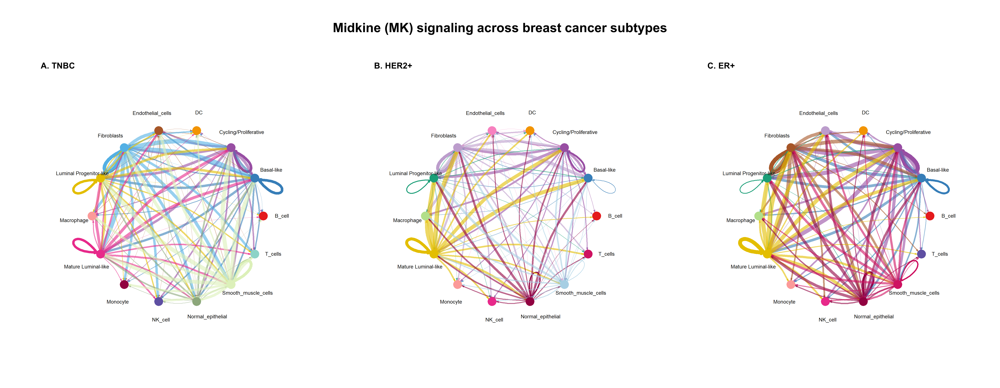

# 🧬 Single-Cell RNA-seq Analysis of the Breast Cancer Tumor Microenvironment


An end-to-end scRNA-seq analysis of breast cancer (GSE176078) that goes beyond standard cell-type mapping: it classifies CNV-high (malignant-candidate) vs. CNV-low epithelial cells, characterizes malignant-state heterogeneity across clinical subtypes, infers cell-cell communication with CellChat (with a focus on midkine, MK), and evaluates a single-cell-derived gene signature as a prognostic marker in an independent bulk cohort (METABRIC).

<p align="center">

</p>

---

## Dataset

| | |
|---|---|
| **Source** | GSE176078 — Wu et al., 2021, *Nat Genet* (26 primary, pre-treatment tumors) |
| **Cells** | 100,064 total → 94,195 after QC |
| **Samples** | 26 patients (11 ER+, 5 HER2+, 10 TNBC) |
| **Validation cohort** | METABRIC (n = 1,980), via cBioPortal |

The raw data are not part of this repository (see `.gitignore`): download GSE176078 into `data/GSE176078/GSE176078/` (including `metadata.csv`) and the METABRIC files into `data/metabric/metabric/`.

---

## Pipeline

```
QC → Normalization → PCA/UMAP → Clustering → SingleR annotation
        │
        ▼
Epithelial subset → chromosome-level CNV score → CNV-high / CNV-low
        │
        ▼
Malignant states → association with clinical subtype
        │
        ▼
CellChat (full object + subtype-stratified comparison) → midkine (MK) analysis
        │
        ▼
Gene signature → METABRIC scoring → survival analysis → signature benchmark
```

## Methods summary

- **QC & clustering:** Standard Seurat v5 workflow (cells with 300–7,000 detected genes and < 15% mitochondrial reads; 2,000 variable genes; 20 PCs; Louvain resolution 0.5); 31 clusters. Cell types annotated with SingleR (Human Primary Cell Atlas, `label.main`) and compared with the labels distributed with the original atlas. About 10% of cells carry labels without a breast-tissue counterpart (e.g. tissue stem cells, chondrocytes); these are not interpreted biologically.
- **CNV-high classification:** A lightweight **chromosome-level** expression-deviation score (SD across chromosomes of the mean reference-adjusted expression; chromosome arms are *not* resolved; 23 chromosomes qualify). Immune and stromal cells form the reference; the cutoff is the 95th percentile of the reference scores (0.025). This proxy replaces inferCNV/CopyKAT for computational feasibility, so CNV-high cells are *malignant candidates* and CNV-low cells are *not confirmed normal*. The classification is benchmarked against the atlas cancer/normal epithelial labels, with a cleaned-reference and a held-out-null sensitivity analysis.
- **Malignant states:** Five curated states (basal-like, luminal progenitor-like, mature luminal-like, EMT/mesenchymal, cycling/proliferative) assigned with `AddModuleScore`; compared across subtypes with patient-level Kruskal-Wallis and Dunn tests, leave-one-patient-out analysis and a per-patient Shannon index.
- **Cell-cell communication:** CellChat (human CellChatDB, `triMean`, `raw.use = TRUE`) on the full object (default 100 permutations, ≤ 800 cells per group) and per subtype (25 permutations, ≤ 300 cells per group), with `liftCellChat` harmonization; MK is additionally checked on a restricted network and with a patient-level expression proxy.
- **Signature & validation:** A 60-gene signature (50 cycling-state markers + 10 MK pathway genes; 55 present on the METABRIC array) scored as the mean gene-wise z-score; Kaplan-Meier and Cox models (OS, OS truncated at 120 months, disease-specific survival) with Schoenfeld tests; benchmarked against its proliferation and MK components, Ki-67, the PAM50 proliferation score and 1,000 random gene sets.

---

## Key Results

| Metric | Value |
|---|---|
| CNV-high (malignant candidate) cells | 10,548 / 22,729 epithelial cells (46.4%) |
| Agreement with the atlas cancer/normal epithelial labels | specificity 99.9%, sensitivity 54.8%; 86.0% after removing cancer-like cells from the reference |
| Malignant states associated with subtype | 5 / 5 (BH p = 0.022–0.048); 4 / 5 when all 19 patients are kept |
| CellChat pathways detected | 111 |
| Midkine (MK) relative information flow, TNBC / HER2+ / ER+ | 0.52 / 0.27 / 0.21 (full network); 0.40 / 0.31 / 0.29 (plausibly annotated groups only) |
| Gene signature size | 60 genes (55 on the METABRIC array) |
| Survival HR, median split, METABRIC | 1.31 (95% CI 1.12–1.53), p = 8.9 × 10⁻⁴ (age- and subtype-adjusted); 1.21 (1.03–1.43) fully adjusted |
| What carries the prognostic signal | the proliferation genes; the MK genes add no significant information and the signature performs like the PAM50 proliferation score |

<p align="center">



</p>

---

## Limitations

- CNV-high classification uses a simplified **chromosome-level** proxy, not inferCNV/CopyKAT. About 10% of the reference cells were cancer-epithelial according to the atlas labels, which made the original cutoff conservative: the CNV-high set is a high-purity but incomplete subset of the malignant cells, and CNV-low cells are not confirmed normal.
- About 10% of cells carry SingleR labels without a breast-tissue counterpart; some of them (iPS- and MSC-labelled cells) are almost entirely cancer-epithelial cells according to the atlas.
- Subtype comparisons rest on few patients (7 TNBC, 8 ER+ and only 4 HER2+ patients contributed CNV-high cells); the choice of a single "strongest" malignant state is not robust.
- CellChat subtype analyses were run on downsampled cells with reduced permutations (`nboot = 25`); the MK difference between subtypes shrinks when groups with implausible labels are excluded.
- The gene signature is dominated by proliferation genes and performs like the PAM50 proliferation score. Proportional hazards do not hold, tumor grade and size were not available, and only one bulk cohort (METABRIC) was used; TCGA-BRCA replication is planned.

---

## Repository Structure

```
├── figures/           # analysis plots (QC, UMAP, GO/KEGG, malignant subtyping, CellChat, signature)
│   └── figures_scripts/   # scripts that regenerate the main figures (Fig. 2–6)
├── results/           # tables and outputs (.csv/.pdf) underlying each figure
├── scripts/           # analysis scripts 01–27, run sequentially
├── main.R
└── README.md
```

---

## Running the Pipeline

```r
install.packages(c("Seurat", "tidyverse", "patchwork", "data.table", "survival", "survminer",
                   "FSA", "pROC", "writexl"))
BiocManager::install(c("SingleR", "celldex", "clusterProfiler", "ReactomePA"))
devtools::install_github("sqjin/CellChat")
devtools::install_github("immunogenomics/presto")
```

Run the scripts in `scripts/` in numerical order from the project root (no `setwd()` calls are used). Random seed 123 is set wherever random sampling is used. The CNV scoring, CellChat and signature-benchmark steps are memory/time-intensive (see in-script notes for downsampling parameters). `scripts/27_Supplementary_tables.R` assembles the supplementary workbook (S1–S14).

---

## Citation

- Wu, S.Z. et al. *A single-cell and spatially resolved atlas of human breast cancers.* Nat Genet 53, 1334–1347 (2021).
- Curtis, C. et al. *Nature* 486, 346–352 (2012) — METABRIC.
- Hao, Y. et al. *Nat Biotechnol* 42, 293–304 (2024) — Seurat v5.
- Jin, S. et al. *Nat Commun* 12, 1088 (2021) — CellChat.

---

## Author

**Bano Rani** — BS Bioinformatics, Department of Computer Science, University of Agriculture Faisalabad

Supervisor: Dr. Sumaira Nishat

⭐ If this project is useful, consider starring the repository.
